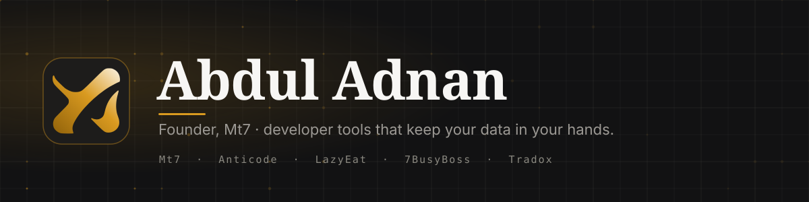

  <b>Abdul Adnan</b> — founder of <a href="https://mt7.io"><b>Mt7</b></a>. I build apps, websites and developer tools, ship fixes upstream, and work heavily in <b>AI &amp; automation</b>. 
  Most of what I ship runs under <b>Mt7 Private Limited</b> and stays private — the repos below are the open slice.

  
  
  
  
  
  
  

### 🏢 Ventures

<table align="center">
  <tr>
    <td align="center" width="33%"><a href="https://mt7.io"><b>Mt7</b></a> Websites, apps, SaaS &amp; custom AI voice agents — in the stack you already run.</td>
    <td align="center" width="33%"><a href="https://anticode.si"><b>Anticode</b></a> Claude, GPT, Gemini + 19 more AI models. One desk, one monthly price.</td>
    <td align="center" width="33%"><a href="https://lazyeat.in"><b>LazyEat</b></a> Order food online across Uttar Pradesh. No surge, no hidden charges.</td>
  </tr>
  <tr>
    <td align="center" width="33%"><a href="https://7busyboss.com"><b>7BusyBoss</b></a> 300+ free online tools. No signup, no pop-ups.</td>
    <td align="center" width="33%"><a href="https://tradox.tech"><b>Tradox</b></a> Market structure &amp; drivers, measured. No buy/sell calls.</td>
    <td align="center" width="33%"><a href="https://mt7.io"><b>+ more coming</b></a> New products ship under Mt7 regularly.</td>
  </tr>
</table>

### 🛠️ Open source

<table align="center">
  <tr>
    <td align="center" width="25%"><a href="https://github.com/abduladnan-mt7/daddyapi"><b>daddyapi</b></a> Website → typed API + MCP tools from one YAML spec. On npm as <code>@daddyapi/cli</code>.</td>
    <td align="center" width="25%"><a href="https://github.com/abduladnan-mt7/browser-pdf"><b>browser-pdf</b></a> Edit PDFs fully in-browser — nothing uploaded. <a href="https://7busyboss.com/pdf-document">Live →</a></td>
    <td align="center" width="25%"><a href="https://github.com/abduladnan-mt7/BasementIO"><b>BasementIO</b></a> One server → your own Vercel + Neon + Upstash. No open ports.</td>
    <td align="center" width="25%"><a href="https://github.com/abduladnan-mt7/greyman-native-swift"><b>Greyman Executive</b></a> Native Swift iOS app.</td>
  </tr>
</table>

  <b>Upstream</b> 
  
  
  
  
  
   <a href="https://github.com/pulls?q=is%3Apr+author%3Aabduladnan-mt7+-user%3Aabduladnan-mt7">all pull requests →</a> · first-time contributor? <a href="https://github.com/abduladnan-mt7/daddyapi/issues?q=is%3Aissue+is%3Aopen+label%3A%22good+first+issue%22">daddyapi good first issues →</a>

### ⚡ Stack

<table align="center">
  <tr>
    <td align="right" valign="middle"><b>AI &amp; automation</b></td>
    <td valign="middle">
      
      
      
      
      
      
      
    </td>
  </tr>
  <tr>
    <td align="right" valign="middle"><b>Languages</b></td>
    <td valign="middle">
      
      
      
      
      
      
      
      
    </td>
  </tr>
  <tr>
    <td align="right" valign="middle"><b>Web &amp; frameworks</b></td>
    <td valign="middle">
      
      
      
      
      
      
      
    </td>
  </tr>
  <tr>
    <td align="right" valign="middle"><b>Mobile</b></td>
    <td valign="middle">
      
      
      
    </td>
  </tr>
  <tr>
    <td align="right" valign="middle"><b>Infra &amp; DevOps</b></td>
    <td valign="middle">
      
      
      
      
    </td>
  </tr>
</table>

### 💼 Work with me

  Freelance, contract and sponsored work — and full client projects through <b>Mt7</b>, delivered end to end.  
  
  
  
  
   Sponsoring funds the open-source projects above — the <b>Sponsor</b> button on this profile goes to GitHub Sponsors.

